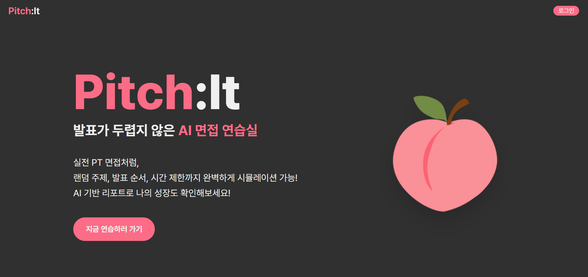
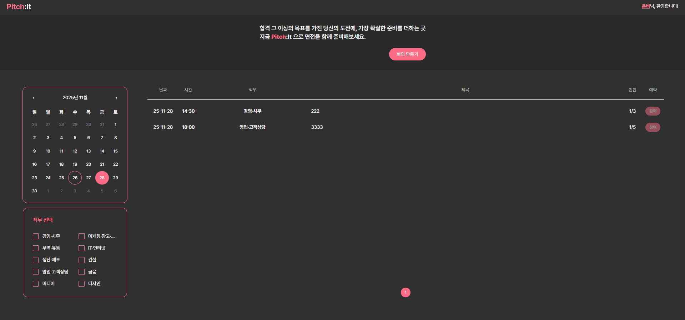
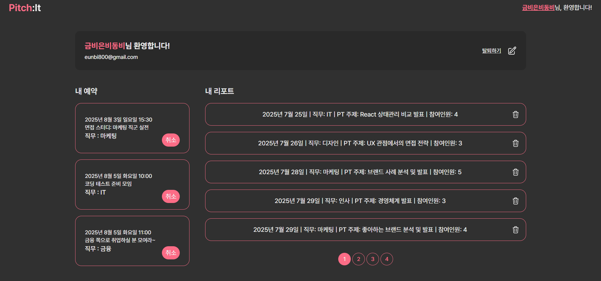
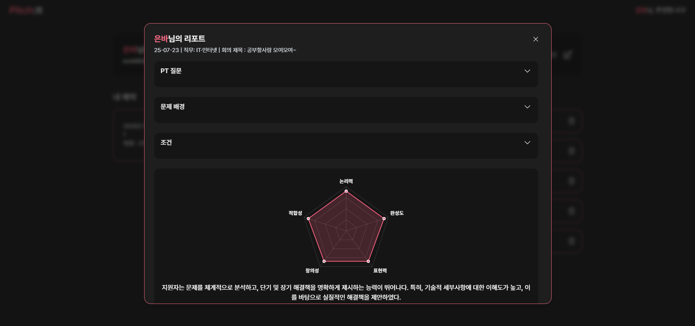
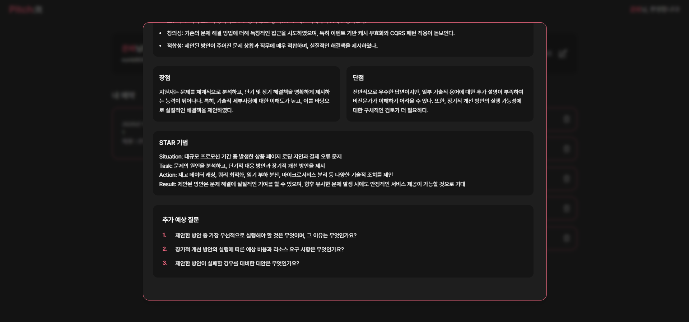

# Pitch:It (피치잇)
### AI 기반 PT 면접 연습 플랫폼

> 실전처럼 연습하고, 구체적인 피드백으로 성장하는 PT 면접 연습 서비스

Pitch:It은 취업 준비생이 실제 PT 면접과 유사한 환경에서 발표를 연습하고, AI가 생성한 피드백 리포트를 통해 개선점을 확인할 수 있는 웹 서비스입니다.

직무별 PT 과제 생성, 다인원 모의 면접, 발표 순서 및 시간 제한, AI 기반 피드백 리포트 등의 기능을 제공합니다.

  

---

## 1. 프로젝트 개요

| 항목      | 내용                                                 |
| ------- | -------------------------------------------------- |
| 프로젝트명   | Pitch:It                                           |
| 진행 기간   | 2025.07.07 ~ 2025.08.18                            |
| 프로젝트 유형 | SSAFY 13기 공통 프로젝트                                  |
| 팀 구성    | 6명                                                 |
| 담당 역할   | Frontend 개발, UI 설계 및 서비스 기획 참여                     |
| 주요 기술   | React, TypeScript, Tailwind CSS, Zustand, Chart.js |

## 2. 기획 배경

### 기존 AI 면접 서비스의 피드백 한계

팀원들과 AI 면접 연습 서비스를 구체화하는 과정에서 기존 서비스의 사용 경험을 조사했습니다.

직접 AI 면접 서비스를 이용해 본 결과, 점수나 간략한 평가만으로는 자신의 부족한 부분과 개선 방향을 파악하기 어렵다는 점을 확인했습니다.

또한 SSAFY 교육생을 대상으로 설문조사를 진행해 구체적인 면접 피드백에 대한 수요를 확인했습니다.

이에 팀원들과 논의하여 **PT 면접에 특화된 연습 환경과 구체적인 AI 피드백을 제공하는 서비스**로 방향을 설정했습니다.

### 해결 방향

* 실제 면접과 유사한 발표 환경 제공
* 직무에 맞는 PT 과제 자동 생성
* 항목별 점수와 시각화된 평가 결과 제공
* 강점과 개선점을 구체적으로 확인할 수 있는 피드백 제공

## 3. 주요 기능

### 3.1 PT 면접 예약 및 참여

* 직무, 날짜, 시간, 최대 참여 인원을 설정하여 면접방 생성
* 직무별 면접방 조회 및 예약
* 최대 5명까지 참여 가능한 모의 면접
* 예약한 면접 일정 확인 및 입장

  

### 3.2 실전형 PT 모의 면접

* 직무별 AI 기반 PT 과제 생성
* PT 과제 확인 후 10분간 발표 준비
* 발표자별 5분 발표 진행
* 무작위 발표 순서 적용
* WebRTC 기반 실시간 화상 면접 환경

### 3.3 AI 기반 피드백 리포트

PT 면접 종료 후 AI가 생성한 평가 결과를 제공합니다.

**5가지 평가 항목**

* 논리력
* 완성도
* 적합성
* 창의성
* 표현력

**상세 피드백**

* 항목별 점수 및 오각형 차트
* 전체 평가 및 항목별 한 줄 평가
* 발표의 강점과 개선점
* STAR 기법을 활용한 피드백
* 추가 예상 질문
* 발표 주제, 조건 및 스크립트 확인

## 4. 담당 역할

### 4.1 서비스 기획 참여

기존 AI 면접 서비스를 직접 이용하며 간략한 피드백만으로는 개선 방향을 파악하기 어렵다는 점을 확인했습니다.

이후 SSAFY 교육생 대상 설문조사 결과를 바탕으로 팀원들과 피드백 기능을 구체화했습니다. 단순한 점수 제공을 넘어 항목별 평가, 강점과 개선점, 추가 예상 질문 등을 통해 사용자가 자신의 발표를 구체적으로 돌아볼 수 있도록 구성했습니다.

### 4.2 마이페이지 구현

사용자가 면접 일정과 피드백 결과를 한곳에서 관리할 수 있도록 마이페이지를 구현했습니다.

  

**회원 정보 관리**

* 닉네임 변경 및 중복 확인
* Enter 키로 변경, ESC 키로 취소
* 회원 탈퇴 기능
* Zustand를 활용한 닉네임 변경 상태와 헤더 연동

**면접 예약 관리**

* 예약한 면접의 날짜, 시간, 직무 표시
* 면접 시작 10분 전 취소 버튼을 입장 버튼으로 전환
* 면접 시작 1분 후 예약 카드 제거

**리포트 관리**

* 리포트 생성 날짜 및 직무 표시
* 리포트 상세 조회 및 삭제
* 리포트 5개 초과 시 페이지네이션 적용

### 4.3 AI 피드백 리포트 UI 구현

AI가 생성한 평가 결과를 사용자가 쉽게 이해할 수 있도록 리포트 화면을 구현했습니다.

  

**평가 결과 시각화**

Chart.js를 활용해 5가지 평가 항목의 점수를 오각형 차트로 표현했습니다.

이를 통해 사용자가 평가 결과를 수치뿐 아니라 시각적으로 비교할 수 있도록 구성했습니다.

**상세 정보 제공**

* 전체 평가 및 항목별 평가 표시
* 강점과 개선점 구분
* STAR 피드백 및 추가 예상 질문 표시
* 드롭다운을 통한 PT 주제, 조건, 스크립트 확인
* ESC 키를 통한 리포트 모달 닫기

  

## 5. UI/UX 설계 및 구현 의도

| 고려한 문제                                | 적용한 방식                               |
| ------------------------------------- | ------------------------------------ |
| 평가 점수만으로 강점과 개선점을 파악하기 어려움 | 5가지 평가 항목을 오각형 차트로 시각화하고 상세 피드백 제공   |
| 예약한 면접과 과거 피드백을 각각 확인해야 하는 불편함        | 마이페이지에서 면접 예약 및 리포트를 통합 관리           |
| 과거 리포트 확인 시 당시 면접 내용을 기억하기 어려움        | 면접 날짜·직무 표시 및 PT 주제·조건·스크립트 조회 기능 제공 |

---

## 6. 기술 스택

| 구분            | 기술                                   |
| ------------- | ------------------------------------ |
| Frontend      | React, TypeScript, Tailwind CSS      |
| 상태 관리 및 시각화   | Zustand, Chart.js                    |
| Backend       | Java 17, Spring Boot                 |
| AI            | Python, FastAPI, Whisper, OpenAI API |
| 실시간 통신        | WebRTC, OpenVidu                     |
| Database      | MySQL, Redis                         |
| Infra         | AWS EC2                              |
| Design        | Figma                                |
| Collaboration | GitLab, Mattermost, Notion           |

※ 프로젝트 전체 기술 스택이며, 개인 담당 영역은 프론트엔드 개발, 일부 UI 설계 및 서비스 기획 참여입니다.

## 7. 프로젝트를 통해 배운 점

Pitch:It 프로젝트를 통해 사용자 요구를 바탕으로 기능을 구체화하고, 이를 실제 화면으로 구현하는 과정을 경험했습니다. 기존 AI 면접 서비스를 직접 이용하고 설문조사 결과를 살펴보면서, 사용자가 필요로 하는 정보를 파악하는 것이 중요하다는 점을 배웠습니다.

또한 마이페이지와 AI 피드백 리포트를 구현하며 사용자가 정보를 쉽게 확인하고 활용할 수 있도록 화면을 구성했습니다. 이를 통해 서비스의 기획 의도가 실제 사용자 경험으로 연결되는 과정의 중요성을 이해하게 되었습니다.
