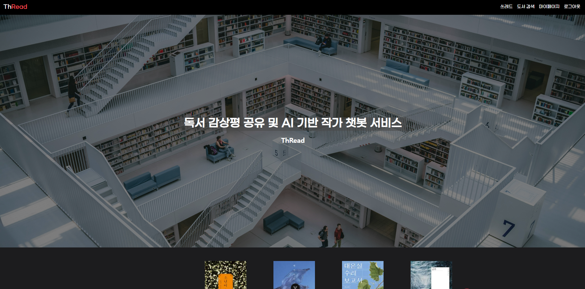
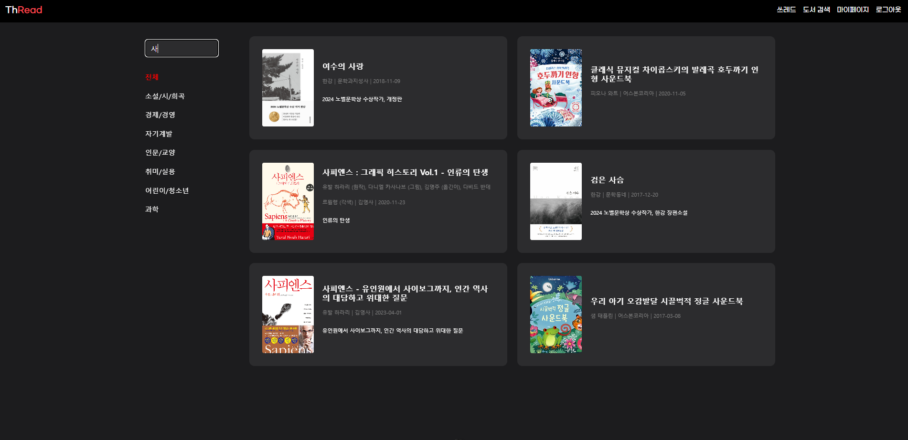
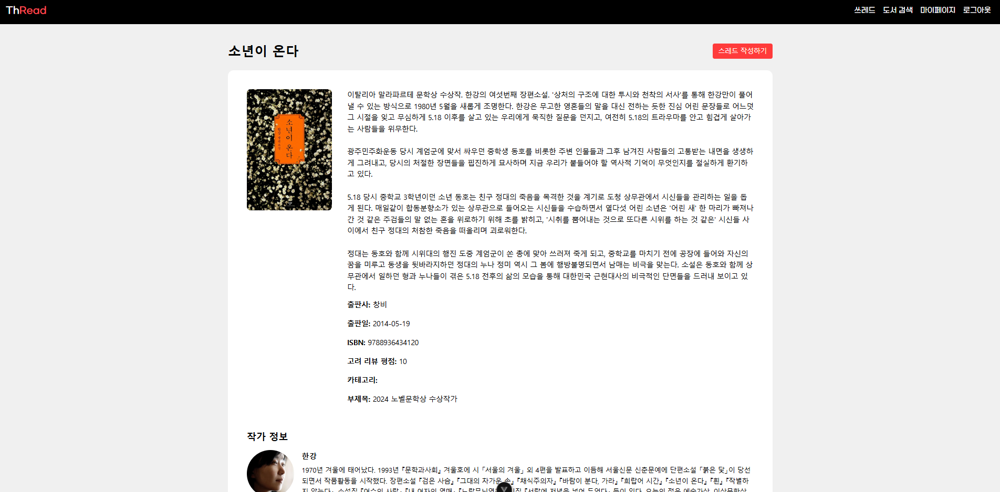
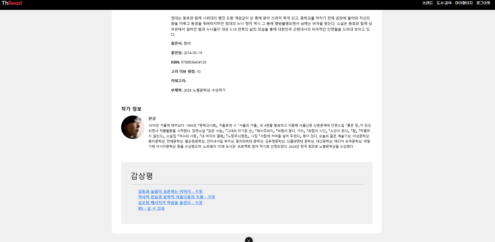
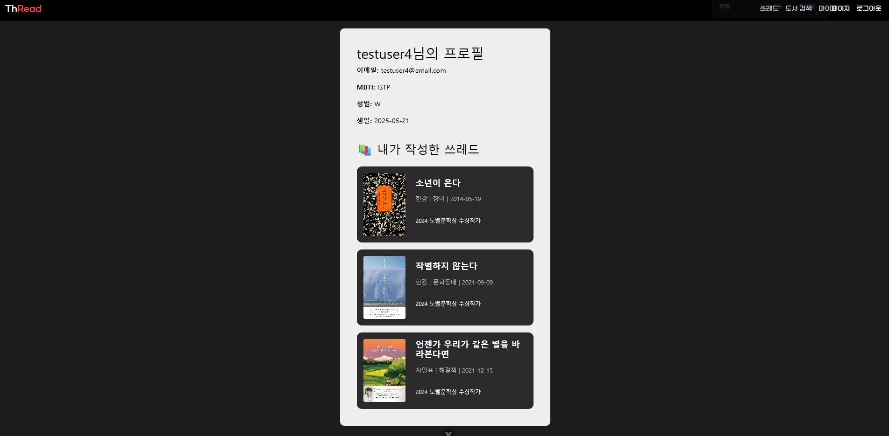
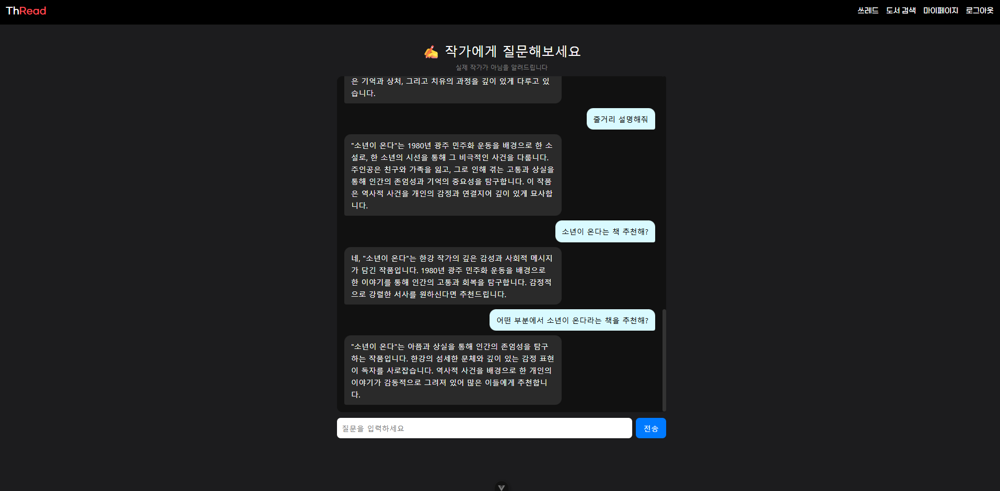
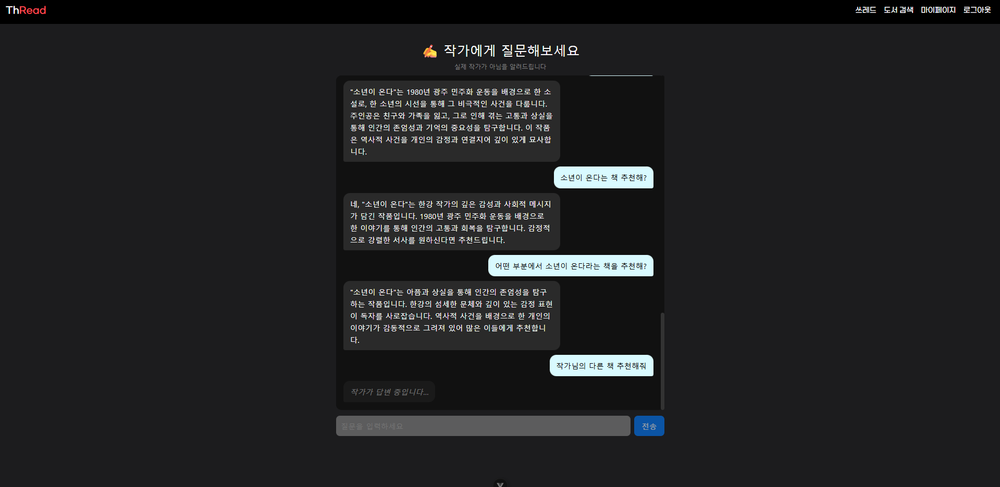

# ThRead (쓰레드)
## 독서 기록 및 공유 플랫폼

> 책을 탐색하고, 기록하고, AI와 함께 이해하는 독서 서비스

ThRead는 도서 검색부터 독서 기록 작성 및 공유, AI 챗봇을 통한 도서·작가 정보 탐색까지 하나의 서비스에서 이용할 수 있는 웹 플랫폼입니다.

사용자는 관심 있는 도서를 검색하거나 카테고리별로 탐색하고, 도서 및 작가 정보를 확인할 수 있습니다. 또한 읽은 책에 대한 감상평을 작성하고 다른 사용자와 공유할 수 있습니다.

  

---

## 1. 프로젝트 개요

| 항목      | 내용                                    |
| ------- | ------------------------------------- |
| 프로젝트명   | ThRead                                |
| 진행 기간   | 2025.05.22 ~ 2025.05.28               |
| 프로젝트 유형 | SSAFY 13기 1학기 관통 프로젝트                 |
| 팀 구성    | 2명                                    |
| 담당 역할   | Frontend, Backend 개발                  |
| 주요 기술   | Vue 3, JavaScript, Django, OpenAI API |

## 2. 프로젝트 배경

SSAFY 1학기 동안 학습한 프론트엔드와 백엔드 기술을 종합적으로 활용하기 위해 진행한 프로젝트입니다.

제공된 요구사항 명세서를 기반으로 도서 검색, 상세 정보 조회, 독서 기록 작성 및 공유 기능을 구현했습니다.

기본 기능 외에도 독서 경험을 확장할 수 있도록 팀원과 추가 기능을 논의했으며, **도서와 작가에 대한 궁금증을 해결할 수 있는 AI 챗봇 기능**을 구현했습니다.

이를 통해 사용자가 책을 탐색하고 기록하는 과정뿐 아니라, 독서 중 궁금한 내용을 확인하는 과정까지 하나의 서비스에서 경험할 수 있도록 했습니다.

## 3. 주요 기능

### 3.1 도서 검색 및 탐색

* 키워드를 활용한 도서 검색
* 카테고리별 도서 탐색
* 검색어와 카테고리를 조합한 도서 조회
* 도서 카드 선택 시 상세 페이지 이동

**도서 검색 화면**

  

### 3.2 도서 및 작가 정보 제공

* 알라딘 API를 활용한 도서 정보 조회
* 도서 상세 정보 및 작가 정보 제공
* 해당 도서에 작성된 독서 기록 확인

**도서 상세 정보**

  

**작가 정보 및 감상평**

  

### 3.3 쓰레드(독서 기록) 작성 및 공유

* 도서별 독서 기록 작성
* 제목, 내용, 읽은 날짜 입력
* 다른 사용자가 작성한 독서 기록 열람
* 카테고리별 독서 기록 조회
* 마이페이지에서 작성한 기록 관리

**마이페이지**

  

### 3.4 AI 챗봇

* OpenAI API 기반 도서·작가 관련 질의응답
* 도서 상세 페이지에서 챗봇 실행
* 도서별 대화 내역 저장 및 조회
* AI 응답 생성 중 로딩 상태 표시
* 실제 작가가 아닌 AI 챗봇임을 안내

**AI 챗봇 대화 화면**

  

**AI 응답 생성 중 로딩 화면**

  

---

## 4. 담당 역할

### 4.1 도서 목록 및 상세 페이지 구현 (Frontend)

Vue 3와 Bootstrap을 활용하여 도서 목록 및 상세 페이지의 레이아웃을 구현했습니다.

**도서 목록 페이지**

* 화면을 검색·카테고리 영역과 도서 목록 영역으로 구분
* 키워드 검색 및 카테고리 선택 UI 구현
* 검색 조건에 따른 도서 카드 표시
* 도서 선택 시 상세 페이지로 이동

**도서 상세 페이지**

* 도서 및 작가 정보를 한 페이지에서 확인할 수 있도록 구성
* 해당 도서에 작성된 독서 기록 목록 표시
* 독서 기록 상세 페이지 연결
* AI 챗봇 접근 기능 제공

### 4.2 AI 챗봇 구현 (Frontend & Backend)

OpenAI API를 활용하여 도서 및 작가 관련 질문에 답변하는 AI 챗봇을 구현했습니다.

**주요 구현 내용**

* 챗봇 인터페이스 및 대화 화면 구현
* OpenAI API를 활용한 응답 생성 기능 연동
* 도서별 대화 내역 저장 및 조회
* AI 응답 생성 중 로딩 상태 표시
* AI 챗봇임을 명시하여 실제 작가와 구분

도서마다 별도의 대화 내역을 관리하도록 구현해 사용자가 이전에 질문했던 내용을 다시 확인할 수 있도록 했습니다.

또한 AI가 응답을 생성하는 동안 로딩 메시지를 표시하여 사용자가 현재 진행 상태를 알 수 있도록 구성했습니다.

### 4.3 회원가입 및 로그인 기능 구현 (Backend)

Django와 Django REST Framework를 활용하여 사용자 인증 및 프로필 관련 API를 구현했습니다.

* 커스텀 사용자 모델 설계
* 회원가입 및 로그인 기능 구현
* 이름, 생년월일, MBTI, 성별 등 추가 정보 저장
* 로그인 사용자 프로필 조회 API 구현
* 본인을 제외한 사용자 목록 조회 API 구현
* 인증된 사용자만 접근할 수 있도록 권한 설정

### 4.4 팔로우·언팔로우 기능 구현 (Backend)

사용자 간 관계를 관리하기 위해 Follow 모델을 설계하고 관련 API를 구현했습니다.

* 사용자 팔로우 및 언팔로우
* 자기 자신에 대한 팔로우 요청 차단
* 중복 팔로우 요청 방지
* 사용자 조회 시 팔로우 여부 및 관계 ID 반환

프론트엔드에서 사용자의 팔로우 상태에 따라 화면을 표시할 수 있도록 필요한 정보를 API 응답에 포함했습니다.

---

## 5. UI/UX 설계 및 구현 의도

| 고려한 문제                            | 적용한 방식                             |
| --------------------------------- | ---------------------------------- |
| 원하는 도서를 찾기 위해 여러 페이지를 이동해야 하는 불편함 | 키워드 검색과 카테고리 탐색을 한 화면에서 제공         |
| 도서와 작가 정보를 각각 확인해야 하는 번거로움        | 도서 상세 페이지에서 도서 및 작가 정보를 함께 제공      |
| 독서 중 궁금한 내용을 별도로 검색해야 하는 불편함      | 도서 상세 페이지에서 AI 챗봇에 바로 접근할 수 있도록 구성 |
| AI 응답을 기다리는 동안 진행 상태를 알기 어려움      | 응답 생성 중 로딩 메시지 표시                  |
| 이전에 나눈 대화를 다시 확인하기 어려움            | 도서별 대화 내역 저장 및 조회 기능 구현            |

## 6. 기술 스택

| 구분              | 기술                                        |
| --------------- | ----------------------------------------- |
| Frontend        | Vue 3, JavaScript, HTML, CSS, Bootstrap   |
| Backend         | Python 3.9, Django, Django REST Framework |
| AI              | OpenAI API                                |
| Database        | SQLite                                    |
| External API    | 알라딘 API                                   |
| API Testing     | Postman                                   |
| Database Design | dbdiagram.io                              |
| Collaboration   | GitLab, Mattermost, Notion                |

※ 프로젝트 전체 기술 스택이며, 개인적으로 프론트엔드와 백엔드 개발에 모두 참여했습니다.

## 7. 프로젝트를 통해 배운 점

ThRead는 프론트엔드와 백엔드를 모두 경험하며 웹 서비스의 데이터 흐름을 이해할 수 있었던 프로젝트입니다. 특히 도서 목록 및 상세 페이지를 구현하고, AI 챗봇의 화면과 API 연동 기능을 개발하면서 사용자 인터페이스와 서버 기능이 연결되는 과정을 경험했습니다.

또한 2인 협업 과정에서 서로의 코드를 수정하거나 변경 사항을 충분히 공유하지 않아 혼선이 발생하기도 했습니다. 이를 통해 역할 분담과 코드 변경 사항 공유의 중요성을 배웠으며, Git과 브랜치 관리에 대한 이해도 높일 수 있었습니다.

짧은 개발 기간으로 인해 기획했던 MBTI별 도서 추천 기능을 완성하지 못한 아쉬움이 남았지만, 기능의 우선순위를 정하고 제한된 일정 안에서 핵심 기능을 구현하는 경험을 쌓았습니다.
