# Yaldi(얄디) - 자율 프로젝트 A308
## AI 멀티에이전트 기반 실시간 ERD 협업 플랫폼

> 설계의 시작부터 협업의 끝까지, Yaldi

Yaldi는 개발자와 기획자 등 다양한 프로젝트 구성원이 데이터베이스 설계 과정을 함께 관리할 수 있도록 만든 **AI 멀티에이전트 기반 실시간 ERD 협업 플랫폼**입니다.

사용자는 하나의 워크스페이스에서 ERD를 생성하고 편집할 수 있으며, WebSocket 기반 실시간 협업, AI 기반 ERD 생성, SQL Import/Export, 버전 관리 등 다양한 기능을 이용할 수 있습니다.

**랜딩페이지**

  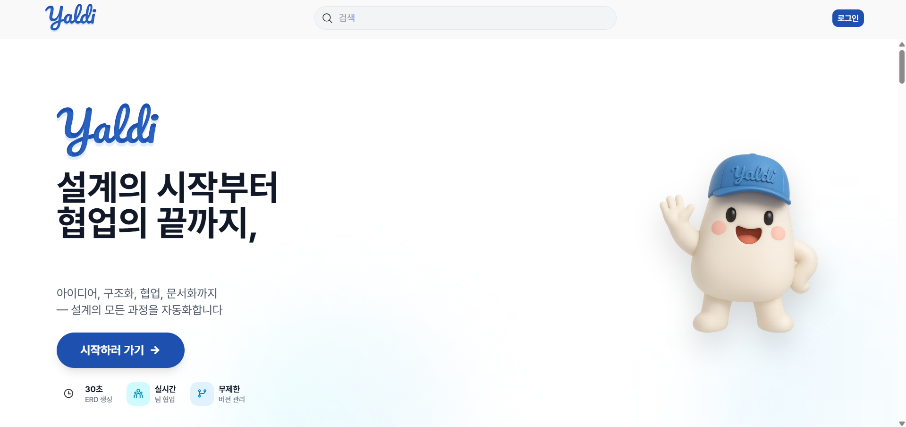

**워크스페이스**

  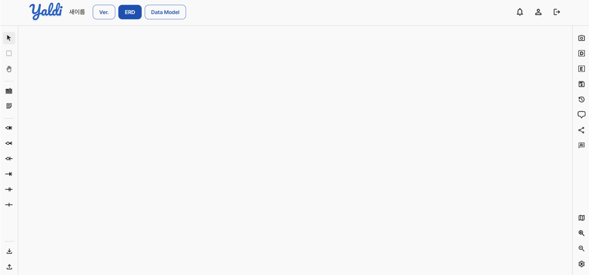

---

## 1. 프로젝트 개요

| 항목      | 내용                                                            |
| ------- | ------------------------------------------------------------- |
| 프로젝트명   | Yaldi(얄디)                                                     |
| 진행 기간   | 2025.10.10 ~ 2025.11.20                                       |
| 프로젝트 유형 | SSAFY 13기 자율 프로젝트                                             |
| 팀 구성    | 6명 (Frontend 2명, Backend 2명, Infra·Backend 1명, AI·Backend 1명) |
| 담당 역할   | 팀장, Frontend, UI/UX 설계                                        |
| 디자인 도구  | Figma, ERDCloud                                               |

---

## 2. 기획 배경

개발 프로젝트에서는 프론트엔드, 백엔드, 기획자 등 여러 구성원이 동일한 데이터 구조를 이해하고 협업해야 합니다.

특히 데이터베이스 설계 과정에서는 ERD를 작성하고 수정하는 것뿐 아니라, 변경 사항을 팀원들과 공유하고 일관된 데이터 모델을 유지하는 것이 중요합니다.

하지만 기존 ERD 설계 도구를 사용하면서 다음과 같은 불편함이 있었습니다.

* 실시간 협업 기능이 제공되지 않거나 유료로 제공되는 경우
* 여러 사용자의 수정 사항이 즉시 반영되지 않아 발생하는 작업 충돌
* ERD 설계 이후 DTO 및 Entity 생성 등 후속 개발 작업을 별도로 진행해야 하는 번거로움

이러한 문제를 해결하기 위해 **ERD 설계부터 실시간 협업, 데이터 모델 활용까지 하나의 플랫폼에서 진행할 수 있는 서비스**를 기획했습니다.

초기에는 의상 추천, 야구 관련 서비스, ERD 협업 도구 등 여러 주제를 검토했습니다. 이후 팀원들의 논의와 투표를 거쳐 실시간 ERD 협업 플랫폼을 최종 주제로 선정했습니다.

기존 ERD 도구의 주요 기능을 참고하되, 실시간 협업과 AI 기반 설계 지원 기능을 결합하는 방향으로 서비스를 구체화했습니다.

---

## 3. 주요 기능

### 3.1 ERD 생성 및 편집

워크스페이스에서 데이터베이스 테이블과 컬럼을 생성하고, 테이블 간 관계를 시각적으로 설정할 수 있습니다.

* 테이블 생성·수정·삭제
* 컬럼 생성·수정·삭제 및 순서 변경
* 테이블 간 관계선 생성·삭제
* 테이블 색상 변경
* 테이블 위치 이동 및 화면 확대·축소
* 메모 추가 및 색상 변경

**ERD 편집 및 관계선 설정 화면**

  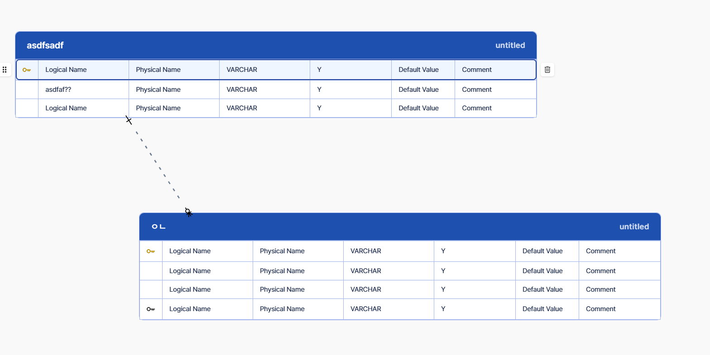

**테이블 편집 화면**

  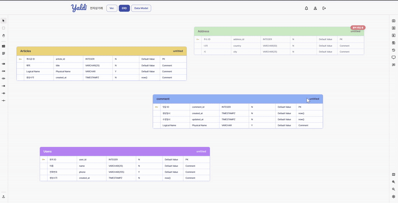

### 3.2 실시간 협업 및 테이블 잠금

WebSocket 기반 양방향 통신을 통해 여러 사용자가 동일한 워크스페이스에서 ERD를 함께 편집할 수 있습니다.

* 테이블·컬럼·관계선 변경 사항 실시간 반영
* 브로드캐스팅을 통한 사용자 간 변경 내용 공유
* 편집 중인 테이블에 잠금(Lock) 적용
* 다른 사용자가 편집 중인 테이블의 중복 수정 방지
* 편집 사용자 표시 및 테이블 반투명 처리
* 다른 테이블 또는 빈 공간 선택 시 잠금 해제

한 사용자가 특정 테이블을 편집하는 동안 다른 사용자가 동일한 테이블을 수정하지 못하도록 제한해 작업 충돌을 방지했습니다.

또한 편집 중인 사용자의 연결 상태를 확인하기 위해 주기적으로 하트비트(Heartbeat)를 전송하도록 구성했습니다.

**테이블 잠금 및 편집 상태 화면**

  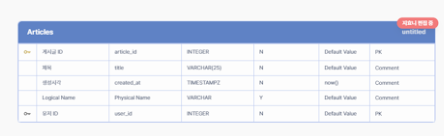

### 3.3 AI 멀티에이전트 기반 설계 지원

AI 멀티에이전트를 활용해 ERD 설계와 데이터 모델링 작업을 지원합니다.

* 프로젝트 주제 및 요구사항 기반 ERD 초안 생성
* 유사 프로젝트 및 설계 패턴 검색
* 데이터베이스 스키마 검증 및 오류 수정 지원
* 정규화, PK, 관계 설정, 데이터 타입 등에 대한 AI 상담
* 컬럼 정보와 제약 조건을 고려한 Mock Data 생성

도메인 분석, 스키마 설계, 관계 정의, 오류 검증 등 역할별 AI Agent를 구성해 사용자의 설계 작업을 지원하도록 했습니다.

※ AI 멀티에이전트 기능은 팀 전체 프로젝트의 구현 내용이며, 개인 담당 영역은 워크스페이스 UI 및 관련 기능 연동입니다.

### 3.4 SQL Import / Export

SQL DDL을 활용해 데이터 모델을 가져오거나 작성한 ERD를 SQL 형태로 내보낼 수 있습니다.

* SQL DDL 기반 Import
* MySQL 및 PostgreSQL 형식 Export
* SQL 미리보기 및 복사
* AI 기반 SQL 검증 및 ERD 생성 지원

**SQL Import 화면**

  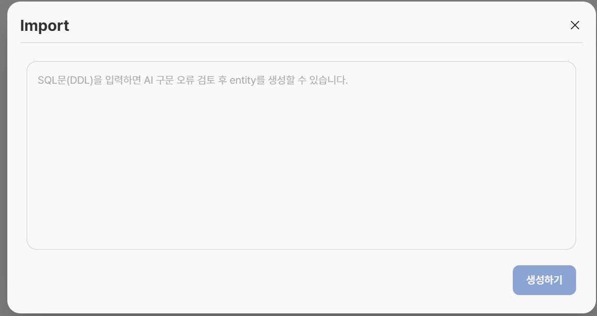

**SQL Export 화면**

  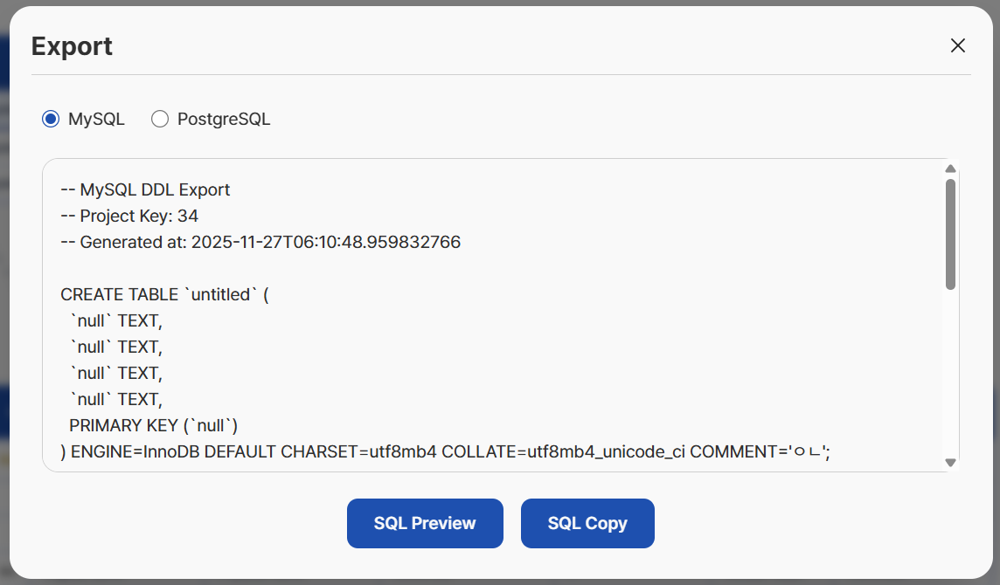

### 3.5 DTO 및 Entity 생성

워크스페이스에서 설계한 테이블과 컬럼을 활용해 DTO 및 Entity를 생성할 수 있습니다.

* 생성 대상 테이블 및 컬럼 선택
* DTO 이름 및 유형 설정
* 선택한 컬럼을 기반으로 DTO 생성
* Entity 생성 기능 제공
* Data Model 페이지에서 생성 결과 확인

**DTO 설정 화면**

  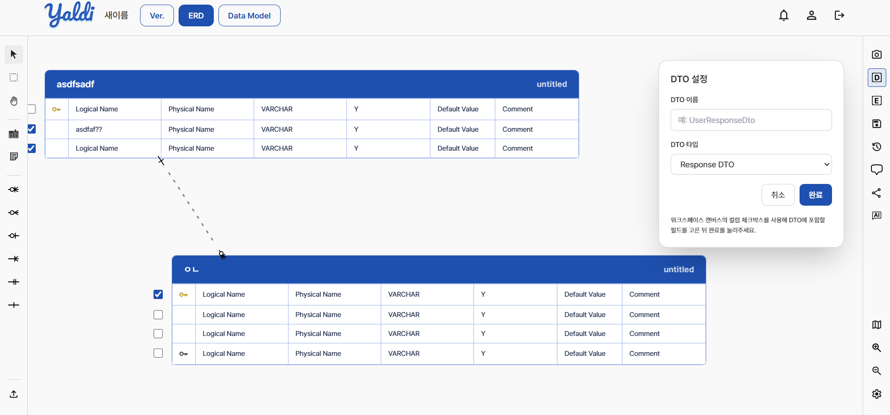

**Entity 생성 화면**

  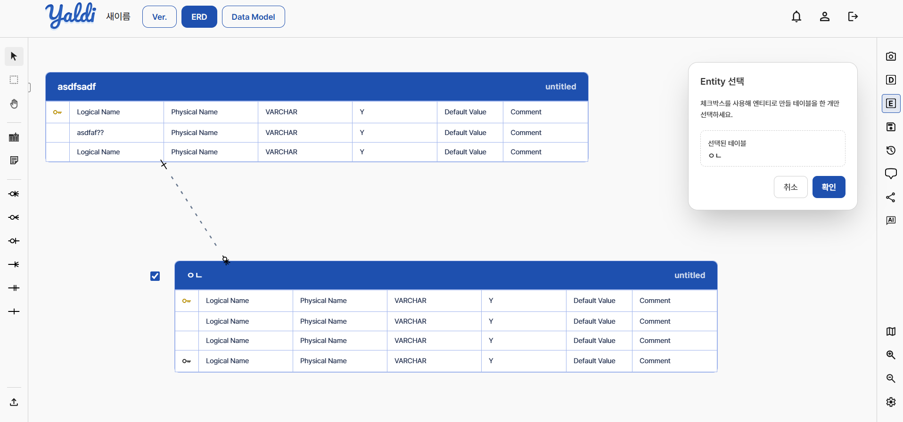

### 3.6 버전 관리 및 스냅샷

ERD 설계 과정에서 발생하는 변경 사항을 관리할 수 있도록 버전 저장 및 스냅샷 기능을 제공합니다.

* 버전 이름 및 설명 입력
* 버전 공개 여부 설정
* 이전 버전과의 변경 사항 확인
* 빌드 성공 여부 확인
* 스냅샷 생성 및 관리
* 이전 상태로 롤백

**버전 저장 화면**

  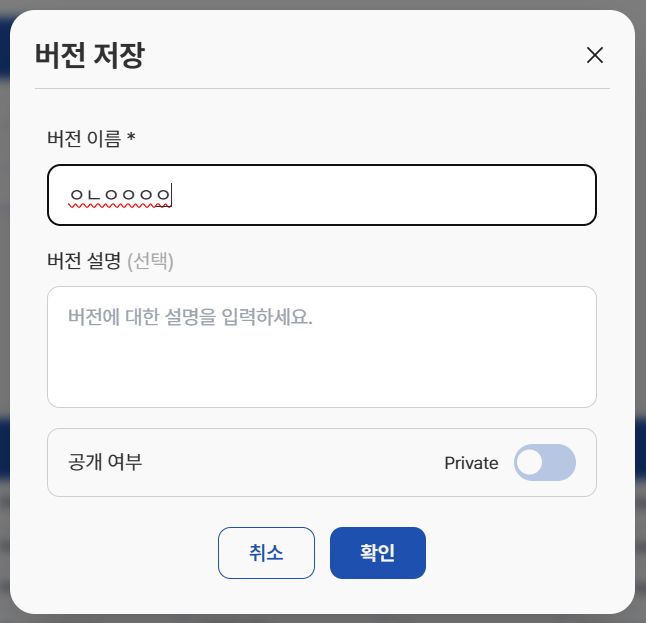

**스냅샷 관리 화면**

  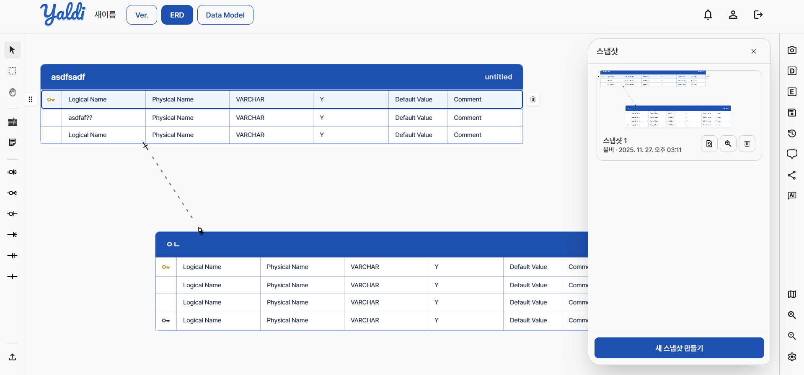

### 3.7 댓글 및 프로젝트 공유

팀원들이 ERD 설계 내용을 논의하고 공유할 수 있도록 협업 기능을 제공합니다.

* 테이블별 댓글 및 대댓글 작성
* 댓글 수정·삭제 및 해결 처리
* 워크스페이스 내 메모 작성
* 프로젝트 공유 링크 생성
* 유효기간이 설정된 뷰어 링크 제공

**테이블 댓글 화면**

  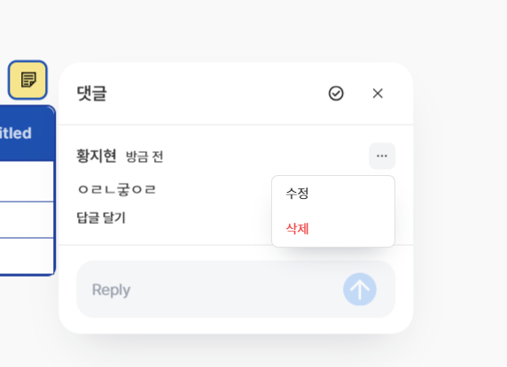

**프로젝트 공유 링크 화면**

  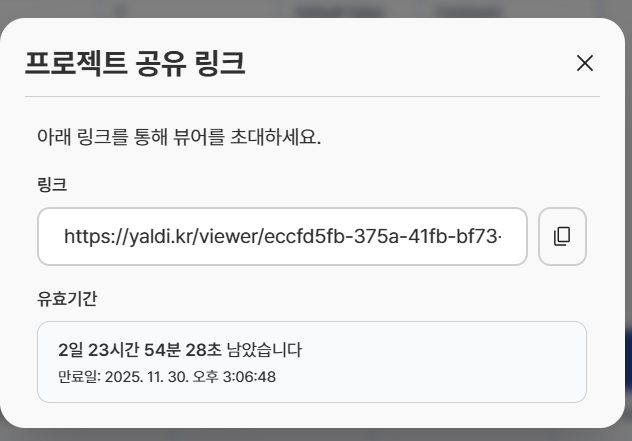

### 3.8 프로젝트 및 팀 관리

사용자는 마이페이지에서 자신이 참여한 팀과 프로젝트를 확인하고 관리할 수 있습니다.

* 사용자 정보 조회 및 수정
* 팀 생성 및 관리
* 참여 프로젝트 목록 확인
* 프로젝트별 워크스페이스 접근

**마이페이지**

  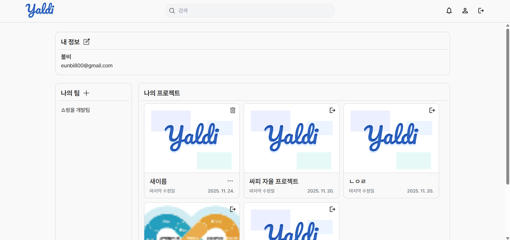

---

## 4. 담당 역할

### 4.1 팀장 및 프로젝트 관리

6인 팀의 팀장으로 참여해 프로젝트 일정과 진행 상황을 관리했습니다.

프로젝트 초기에는 팀원들과 서비스 주제를 논의하고 기능을 구체화하는 과정에 참여했습니다.

개발 과정에서는 각 담당 영역의 진행 상황을 확인하고, 기능 구현 과정에서 발생하는 문제를 팀원들과 공유하며 협업했습니다.

**주요 수행 내용**

* 프로젝트 주제 선정 및 기능 기획 논의 참여
* 개발 일정 및 진행 상황 관리
* 팀원 간 협업 및 개발 이슈 조율
* 최종 결과물 완성을 위한 개발 일정 관리

### 4.2 UI/UX 설계

Figma를 활용해 서비스의 일부 화면 설계에 참여했습니다.

특히 다양한 편집 기능이 집중되는 워크스페이스에서 사용자가 필요한 기능을 찾고 조작할 수 있도록 화면 구성과 사용자 흐름을 고려했습니다.

**주요 고려 사항**

**① 기능별 도구 모음 구성**

ERD 편집 과정에서 자주 사용하는 테이블 생성, 관계선 연결, 메모, Import/Export 기능과 부가 기능을 구분해 사용할 수 있도록 구성했습니다.

**② 편집 상태의 시각적 표현**

다른 사용자가 편집 중인 테이블을 구분할 수 있도록 잠금 상태와 편집 사용자 정보를 화면에 표시했습니다.

**③ 작업 공간 중심의 화면 구성**

ERD를 편집하는 중앙 워크스페이스를 중심으로 기능별 사이드바와 상단 메뉴를 배치해 작업 흐름을 유지할 수 있도록 했습니다.

### 4.3 Frontend 개발

**① 메인페이지 UI 수정**

기존에 다른 팀원이 구현한 메인페이지를 이어받아 서비스 소개 문구, 색상 및 UI를 수정했습니다.

**② 로그인·회원가입 UI 구현**

* Google 및 GitHub OAuth 로그인 버튼 UI 구현
* 회원가입 화면 레이아웃 구현
* 닉네임 입력 및 중복 안내 인터페이스 구현
* 계정 통합 안내 모달 UI 구성

로그인 기능의 완성 과정에서는 OAuth 구현 경험이 있는 다른 프론트엔드 팀원과 협업했습니다.

**③ 워크스페이스 전체 UI 구현**

ERD를 생성하고 편집하는 핵심 작업 공간인 워크스페이스의 프론트엔드 구현을 담당했습니다.

* 좌측 편집 도구 모음 및 우측 기능 패널 UI 구현
* 테이블 및 컬럼 편집 인터페이스 구현
* 테이블 잠금 상태 및 편집 사용자 표시
* 메모, 댓글, 관계선 등 워크스페이스 기능 UI 구현
* 워크스페이스 관련 API 연결

**④ 주요 기능 API 연동**

다음 기능의 API를 연동했습니다.

* 테이블 생성·수정·삭제
* 컬럼 생성·수정·삭제
* 관계선 생성·삭제
* SQL Import / Export
* DTO 및 Entity 생성
* 버전 저장 및 히스토리
* 댓글 모아보기
* AI 챗봇 및 설정

**⑤ WebSocket 기반 실시간 협업 기능 적용**

* WebSocket 및 STOMP 기반 실시간 통신 기능 연동
* 테이블·컬럼·관계선 변경 사항 브로드캐스팅 적용
* 사용자 간 변경 사항 동기화 확인
* 테이블 잠금 상태 반영
* 실시간 통신 과정에서 발생한 오류 수정

---

## 5. 기술 스택

| 구분                          | 기술                                               |
| --------------------------- | ------------------------------------------------ |
| Frontend                    | React, TypeScript, Tailwind CSS                  |
| Real-time Communication     | WebSocket, SockJS, STOMP.js, SSE                 |
| Backend                     | Java 21, Spring Boot, Spring WebSocket           |
| AI                          | Python, FastAPI                                  |
| Database                    | PostgreSQL, Redis, Elasticsearch, MariaDB, Neo4j |
| Storage                     | Amazon S3                                        |
| Messaging                   | Apache Kafka                                     |
| Infra                       | AWS EC2, Docker, Docker Compose, Nginx           |
| CI/CD                       | Jenkins                                          |
| API Documentation & Testing | Swagger, Postman                                 |
| Design                      | Figma, ERDCloud                                  |
| Collaboration               | GitLab, Notion, Mattermost                       |

※ 기술 스택은 프로젝트 전체 기준이며, 개인 담당 영역은 **팀장, UI/UX 설계, 프론트엔드 개발 및 실시간 협업 기능 연동**입니다.

---

## 6. 구현 과정에서의 문제 해결

### 6.1 WebSocket 기반 실시간 동기화 문제

Yaldi의 핵심 기능은 여러 사용자가 동일한 ERD를 동시에 편집할 수 있는 실시간 협업 기능이었습니다.

이를 구현하기 위해 WebSocket과 STOMP의 동작 방식을 학습하고, AI 코딩 도구의 도움을 받아 메시지 처리 및 브로드캐스팅 관련 코드를 작성해 적용했습니다.

**발생한 문제**

본인 환경에서는 테이블 변경 사항이 정상적으로 반영되었지만, 다른 팀원의 화면에서는 수정 내용이 실시간으로 나타나지 않는 문제가 발생했습니다.

**해결 과정**

1. 본인 화면과 다른 팀원의 화면을 함께 확인하며 문제를 재현했습니다.
2. 실시간 통신 관련 코드와 발생한 증상을 AI 코딩 도구에 전달해 문제를 분석했습니다.
3. 제안된 수정 사항을 반영하고 관련 코드를 수정했습니다.
4. 화면을 분할해 서로 다른 사용자 환경에서 변경 사항이 반영되는지 다시 확인했습니다.

이 과정에서 프론트엔드와 백엔드의 메시지 처리 방식이 일치해야 실시간 협업 기능이 정상적으로 동작한다는 점을 이해했습니다.

### 6.2 프론트엔드와 백엔드 간 통신 구조 불일치

WebSocket 기능을 구현하면서 백엔드에서 공유받은 초기 통신 구조를 참고해 프론트엔드 코드를 작성했습니다.

하지만 개발 과정에서 백엔드의 메시지 처리 구조에 변경 사항이 추가되었고, 이를 충분히 공유받지 못해 양쪽 코드가 일치하지 않는 문제가 발생했습니다.

**해결 과정**

* 백엔드 담당 팀원과 통신 구조 및 변경 사항 확인
* 프론트엔드 코드와 백엔드 처리 방식 비교
* 서로 맞지 않는 부분을 확인하고 수정
* 변경 사항을 적용한 뒤 통신 동작 재확인

이를 통해 실시간 통신 기능에서는 각 개발자가 자신의 코드만 확인하는 것이 아니라, **서로 주고받는 메시지와 엔드포인트를 명확하게 공유하는 과정**이 중요하다는 점을 배웠습니다.

또한 API 및 WebSocket 통신 규칙을 문서화해 관리했다면 개발 과정의 혼선을 줄일 수 있었겠다는 개선점을 발견했습니다.

### 6.3 개발 일정 관리

프로젝트 초기에는 최종 발표 3일 전까지 개발을 완료하고, 남은 기간을 발표 자료 및 홍보 영상 제작에 활용할 계획이었습니다.

하지만 서비스 기획을 구체화하는 데 약 2주가 소요되었고, 개발 과정에서도 실시간 통신 및 로그인 관련 문제가 발생하면서 일정이 지연되었습니다.

결과적으로 발표 전날까지 개발을 진행하게 되었습니다.

이를 통해 기능 구현에 필요한 시간을 예상하는 것뿐 아니라, **기획 단계에서 핵심 기능의 우선순위를 정하고 예상하지 못한 오류에 대응할 시간을 확보하는 것**이 중요하다는 점을 배웠습니다.

---

## 7. 회고

Yaldi 프로젝트에서는 처음으로 팀장을 맡아 서비스 기획부터 개발, 협업, 일정 관리까지 프로젝트의 전반적인 과정을 경험했습니다.

특히 워크스페이스 전체 UI를 담당하면서 다양한 기능을 하나의 화면에 구성하고, 사용자에게 필요한 기능을 연결하는 경험을 쌓았습니다.

기술적으로는 WebSocket과 STOMP를 새롭게 학습하고 실시간 협업 기능을 구현했습니다. 개발 과정에서 AI 코딩 도구를 활용하기도 했지만, 실제 서비스에 적용한 뒤 다른 사용자 환경에서 정상적으로 동작하는지 확인하고 문제를 수정하는 과정이 필요했습니다.

또한 프론트엔드와 백엔드 간 통신 구조가 일치하지 않아 발생한 문제를 해결하면서, **기술 구현 능력뿐 아니라 개발자 간 명확한 소통과 문서화가 중요하다**는 점을 배웠습니다.

팀장으로서는 일정 관리에 아쉬움이 남았습니다. 기획과 개발 과정에서 예상보다 많은 시간이 소요되었고, 최종 발표 직전까지 기능을 수정해야 했습니다.

이를 통해 프로젝트를 안정적으로 완성하기 위해서는 기능의 우선순위를 명확하게 설정하고, 개발 진행 상황을 지속적으로 확인하며 일정에 여유를 두는 것이 중요하다는 점을 깨달았습니다.

이번 프로젝트는 복잡한 기능을 사용자에게 제공하는 UI/UX 설계와 실제 서비스 구현, 협업 과정에서 발생하는 문제 해결을 함께 경험할 수 있었던 프로젝트였습니다.
