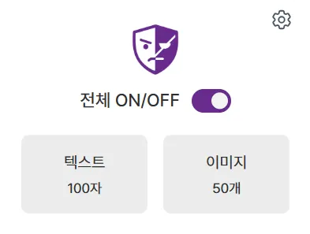
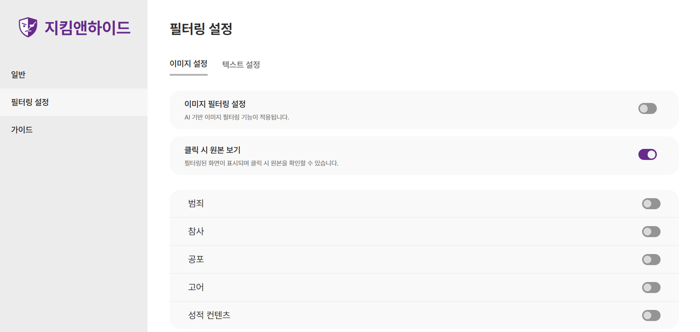
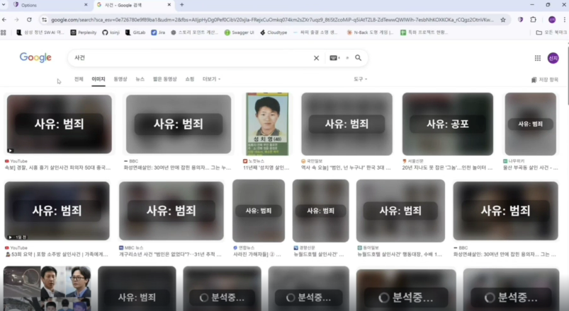
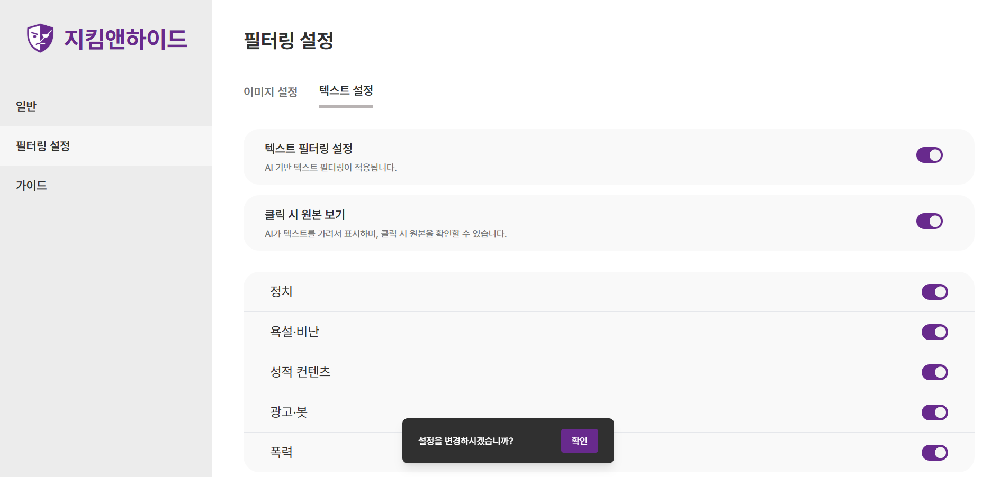
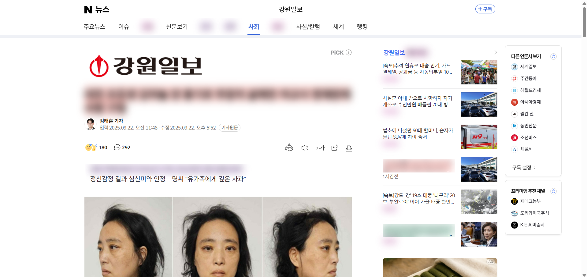
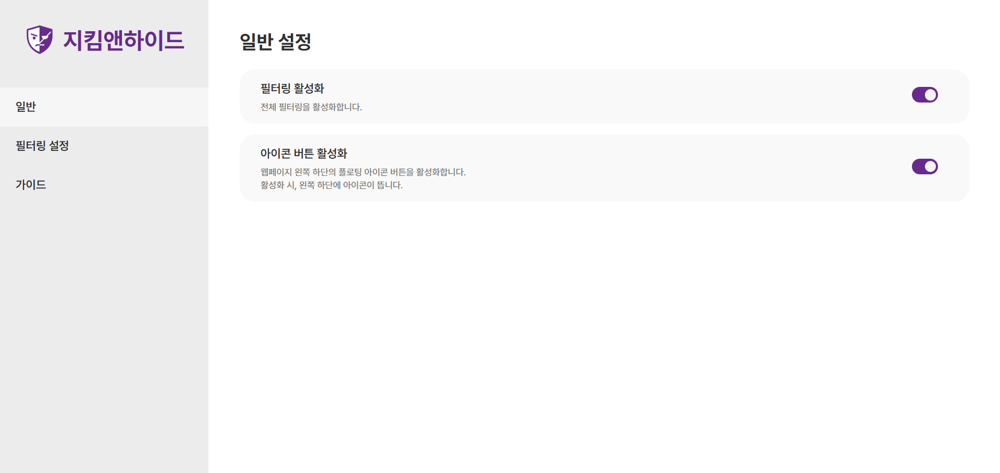
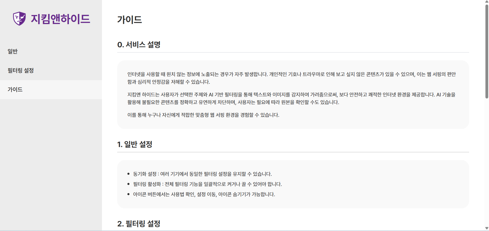

# 지킴앤하이드(jikimandhyde) - 빅데이터 분산 A207
## AI 기반 유해 콘텐츠 필터링 Chrome Extension

> 나에게 위험한 콘텐츠는 피하고, 안전하게 웹서핑하자.

지킴앤하이드는 웹사이트에서 원치 않는 유해 텍스트와 이미지를 필터링하는 크롬 확장 프로그램입니다.
사용자가 필터링할 콘텐츠의 종류를 직접 선택하고, 필요에 따라 기능을 켜거나 끌 수 있도록 설계했습니다.

  

---

## 1. 프로젝트 개요

| 항목      | 내용                              |
| ------- | ------------------------------- |
| 프로젝트명   | 지킴앤하이드                          |
| 진행 기간   | 2025.08.25 ~ 2025.09.29         |
| 프로젝트 유형 | SSAFY 13기 특화 프로젝트               |
| 팀 구성    | 6명 (Frontend 2명, Backend·AI 4명) |
| 담당 역할   | Frontend, UI/UX 설계              |
| 디자인 도구  | Figma                           |

## 2. 기획 배경

유튜브, 뉴스 기사, 커뮤니티 등에서 원치 않는 혐오 표현이나 자극적인 이미지에 노출되는 문제에서 출발했습니다.

사용자가 모든 콘텐츠를 직접 확인하고 피하기보다는, **자신에게 불편한 콘텐츠의 유형을 선택하고 자동으로 필터링할 수 있는 서비스**를 만들고자 했습니다.

초기에는 텍스트 순화, 특정 단어 차단, 영상 내 유해 콘텐츠 건너뛰기 등 다양한 기능을 논의했습니다. 이후 개발 기간과 기술적 제약을 고려해 텍스트 및 이미지 필터링을 핵심 기능으로 선정했습니다.

## 3. 주요 기능
### 3.1 이미지 필터링

* 유해 이미지 및 썸네일 블러 처리
* 필터링된 이미지에 차단 사유 표시
* 사용자별 이미지 필터링 카테고리 설정
* 필터링 기능 ON/OFF 및 원본 보기 설정

**이미지 필터링 설정 화면**

  

**이미지 필터링 적용 화면**

  

### 3.2 텍스트 필터링

* 댓글, 본문, 사용자명 등에 포함된 유해 표현 필터링
* 필터링 사유에 따라 색상 구분
* 사용자별 텍스트 필터링 카테고리 설정
* 필요시 원문 확인 가능

**텍스트 필터링 설정 화면**

  

**텍스트 필터링 적용 화면**

  

### 3.3 사용자 맞춤 설정

* 전체 필터링 ON/OFF
* 이미지·텍스트 필터링 개별 설정
* 카테고리별 필터링 범위 설정
* 크롬 계정 기반 설정 동기화
* 사용 가이드 제공

**일반 설정화면**

  

## 4. 담당 역할
### UI/UX 설계

프로젝트의 전체 화면 와이어프레임과 UI/UX 설계를 전담했습니다.
서비스의 주요 기능은 팀원들과 함께 논의했으며, 화면 구성과 사용자 흐름은 직접 판단하고 Figma로 설계했습니다.

**주요 설계 사항**

**① 이미지·텍스트 필터링 설정 분리**

두 기능의 설정 항목과 카테고리가 다르다는 점을 고려해 설정 화면을 분리했습니다.
사용자가 필요한 필터링 기능을 각각 관리할 수 있도록 구성했습니다.

**② 전체 필터링 ON/OFF 제공**

개별 설정을 변경하지 않아도 전체 필터링 기능을 빠르게 켜거나 끌 수 있도록 메인 화면과 확장 프로그램 팝업에 전체 제어 기능을 배치했습니다.

**③ 사용 가이드 구성**
크롬 확장 프로그램을 처음 사용하는 사용자도 기능과 설정 방법을 이해할 수 있도록 가이드 화면을 설계했습니다.

  

### Frontend 개발

* React, TypeScript, Tailwind CSS 기반 개인 설정 페이지 구현
* 크롬 확장 프로그램 UI 개발
* 프론트엔드 초기 스켈레톤 코드 작성
* `chrome.storage.sync` 및 `chrome.storage.local`을 활용한 사용자 설정 저장
* 서버 응답 결과에 따른 설정 저장 및 이전 설정 복원 처리

## 5. 기술 스택

| 구분               | 기술                                      |
| ---------------- | --------------------------------------- |
| Frontend         | React, TypeScript, Tailwind CSS         |
| Chrome Extension | Manifest V3, Chrome Storage API         |
| Backend          | Spring Boot, FastAPI                    |
| AI               | KLUE, EfficientNetV2, MobileNetV3-Large |
| Database         | Redis, MySQL                            |
| Infra            | AWS EC2, Docker, Jenkins                |
| Design           | Figma                                   |
| Collaboration    | GitLab, Notion, Mattermost              |

※ 기술 스택은 프로젝트 전체 기준이며, 개인 담당 영역은 UI/UX 설계 및 프론트엔드 개발입니다.

## 6. 구현 과정에서의 문제해결

### 사용자 설정 저장 및 동기화

사용자가 다른 기기에서도 동일한 필터링 설정을 이용할 수 있도록 Chrome Storage API를 활용했습니다.

* 로그인 상태: `chrome.storage.sync` 활용
* 비로그인 상태: `chrome.storage.local` 활용
* 비로그인 상태에서 로그인하면 로컬 설정을 동기화 저장소에 반영

초기에는 설정 변경 시 자동 저장하는 방식을 시도했지만, 서버에 설정이 정상적으로 전달되지 않는 문제가 발생했습니다.

이를 해결하기 위해 설정 변경 후 확인 버튼을 누르면 서버에 데이터를 전송하고, 성공 응답을 받은 경우에만 Chrome Storage에 저장하도록 방식을 변경했습니다.

서버 요청에 실패하면 이전 설정을 다시 표시하도록 처리했습니다.

## 7. 회고

지킴앤하이드 프로젝트에서는 전체 UI/UX 설계와 프론트엔드 구현을 담당하며 사용자 편의성과 기술적 구현 가능성을 함께 고려하는 경험을 쌓았습니다. 특히 사용자가 필터링 기능을 쉽게 이해하고 관리할 수 있도록 화면 구조와 이용 흐름을 설계하면서 사용자 관점에서 기능을 구성하는 것의 중요성을 배웠습니다.

한편 기획에 예상보다 많은 시간이 소요되면서 개발 일정이 촉박해졌고, 일부 기능을 충분히 완성하거나 검증하지 못한 아쉬움이 남았습니다. 이를 통해 기능의 우선순위를 명확히 정하고, 팀원들과 진행 상황을 공유하며 일정을 관리하는 것이 서비스 완성도에 중요하다는 점을 배웠습니다.

